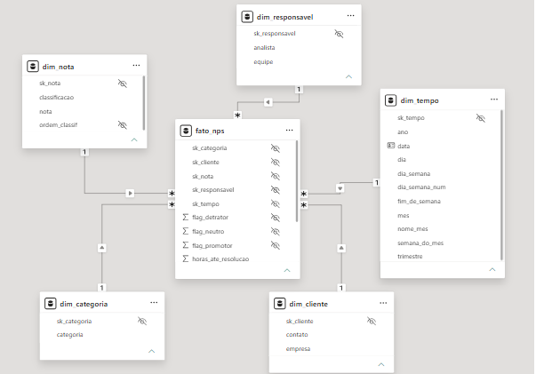
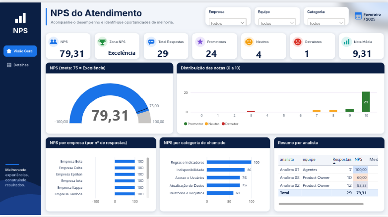

# Data Warehouse de NPS — PostgreSQL + Power BI

Projeto da disciplina **Banco de Dados II** — *Projeto 3: nova "área de dados" (Análise de Dados)*.

Data Warehouse em **PostgreSQL**, em modelo estrela, com as respostas da pesquisa de **NPS** do atendimento de uma empresa SaaS (Fevereiro/2025). A carga é feita por uma **stored procedure**, a regra do NPS é garantida por um **trigger** e duas **views** entregam consultas prontas. Um dashboard em **Power BI** consome o banco.

> **Resultado:** 29 respostas · 24 promotores · 4 neutros · 1 detrator · **NPS 79,3**

## Assuntos da disciplina aplicados

| Assunto | Onde está |
| --- | --- |
| **Views** | `vw_nps_respostas` (alimenta a página Detalhes do Power BI), `vw_nps_por_empresa` (valida o NPS do dashboard) |
| **Trigger** | `trg_classificar_nps` (função `fn_classificar_nps`) |
| **Stored procedure** | `sp_carregar_dw()` |
| **Modelagem dimensional** | `fato_nps` + 5 dimensões |
| **Restrições e índices** | PK, FK, UNIQUE, CHECK e índices nas chaves estrangeiras |

## Estrutura

```
├── sql/
│   ├── 01_criar_dw.sql                # tabelas e índices
│   ├── 02_view_trigger_procedure.sql  # trigger, procedure e views
│   ├── 03_validacao.sql               # conferência dos números
│   └── 04_Demonstracao_Validacao.sql  # roteiro de testes da apresentação
├── dados/nps_fev2025_anonimizado.csv  # 29 respostas anonimizadas
├── powerbi/                           # .pbix, PDF e medidas DAX
└── docs/                              # imagens do modelo e do dashboard
```

## Modelo dimensional

Grão da fato: **uma resposta de NPS de um chamado**. Regra: notas 9–10 = Promotor, 7–8 = Neutro, 0–6 = Detrator. **NPS = % Promotores − % Detratores.**

```
                    dim_tempo
                        |
 dim_cliente ------- fato_nps ------- dim_responsavel
 (empresa, contato)     |              (analista, equipe)
                        |
        dim_categoria --+-- dim_nota
                            (nota 0-10, classificacao)
```



## Objetos do banco

- **`trg_classificar_nps`**: antes de gravar ou alterar qualquer linha da fato, bloqueia notas fora de 0 a 10 e recalcula `sk_nota` e as flags de Promotor, Neutro e Detrator.
- **`sp_carregar_dw()`**: carrega o modelo estrela a partir da tabela de staging (`stg_nps`) com um único `CALL`. Recusa rodar com a staging vazia e pode ser executada várias vezes.
- **`vw_nps_respostas`**: uma linha por resposta, com os nomes de todas as dimensões.
- **`vw_nps_por_empresa`**: NPS por empresa. Também valida o dashboard, porque mostra o mesmo NPS calculado no banco.

## Como executar

Requisitos: PostgreSQL 16 e um cliente SQL (DBeaver ou pgAdmin).

| # | Ação |
| --- | --- |
| 1 | `CREATE DATABASE dw_nps ENCODING 'UTF8';` |
| 2 | Conectado ao `dw_nps`, executar `sql/01_criar_dw.sql` |
| 3 | Executar `sql/02_view_trigger_procedure.sql` |
| 4 | Importar `dados/nps_fev2025_anonimizado.csv` na tabela `stg_nps` (CSV, UTF-8, delimitador `,`, com cabeçalho) |
| 5 | `CALL sp_carregar_dw();` |
| 6 | Executar `sql/03_validacao.sql` |

Resultado esperado da validação: **29 respostas, 24 promotores, 4 neutros, 1 detrator, NPS 79,3.**

**Roteiro completo de testes:** `sql/04_Demonstracao_Validacao.sql` (12 testes de views, trigger e procedure, com o resultado esperado de cada um). Resumo do trigger:

```sql
UPDATE fato_nps SET nota = 15 WHERE ticket_id = 1002;  -- ERRO: nota inválida
UPDATE fato_nps SET nota = 9  WHERE ticket_id = 1002;  -- Neutro passa a Promotor
SELECT nota, flag_promotor, flag_neutro FROM fato_nps WHERE ticket_id = 1002;
CALL sp_carregar_dw();                                   -- desfaz o teste
```

## Dashboard

O Power BI se conecta ao PostgreSQL (servidor localhost, banco dw_nps, modo Importar) e lê *7 objetos do banco*:

- as *6 tabelas do modelo estrela* (fato_nps + 5 dimensões), que alimentam a página *Visão Geral* (cartões de NPS, gráficos por empresa, categoria e analista);
- a *view vw_nps_respostas, que alimenta a página **Detalhes*: uma tabela com uma linha por resposta, já com empresa, contato, analista, categoria e classificação.

A página Detalhes usa a view porque ela já faz os 5 JOINs da fato com as dimensões dentro do banco. Assim, o Power BI recebe os dados prontos e a regra de junção fica num lugar só. Já a view vw_nps_por_empresa serve para validar o dashboard: o NPS de cada empresa calculado no banco tem que ser igual ao que aparece no gráfico "NPS por empresa".

As medidas DAX estão em powerbi/medidas_dax.txt.



## Anonimização (LGPD)

Empresas, contatos e atendentes foram trocados por nomes fictícios (`Empresa Alpha`, `Contato 01`, `Analista 01`) **antes** de entrar no banco. O assunto dos chamados, que citava clientes e parceiros, virou 5 categorias genéricas. Os números de ticket também foram substituídos por uma sequência fictícia (1001 a 1029).

## Limitações

Amostra pequena: 29 respostas, e 7 das 11 empresas têm só 1 resposta, então o NPS delas fica em −100, 0 ou 100. Uma empresa concentra 52% das respostas.

---

**Autor(a):** Rosane Neckel e Glauco Acassio · Sistemas para Internet · Banco de Dados II
